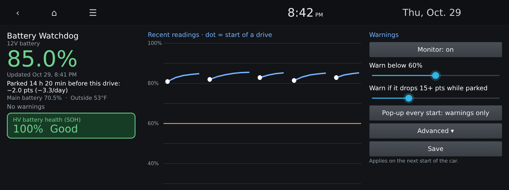

# Battery Watchdog

A [NEMESIS](#requirements) package for Hyundai and Kia cars with the
**Gen5W** head unit. It keeps an eye on the **12V battery** and warns you on
the car's screen before a weak battery or a charging problem leaves you
unable to start the car.

On E-GMP cars like the Ioniq 5, a dead 12V battery means the car won't turn
on, even with a full main battery. Battery Watchdog logs the 12V charge level
on every drive and tells you when something looks wrong.


<sub>Mockup of the app on the 1920×720 Gen5W screen, with sample data.</sub>

> Unofficial. Not affiliated with Hyundai, Kia or HKMC. Use at your
> own risk. Battery Watchdog only **reads** values from the car, and it
> doesn't read anything until it has confirmed it's talking to the right
> functions on your firmware (see [Safety](#safety)).

## Features

- **12V charge level** at the start of every drive and every 5 minutes while
  the screen is on.
- **Warnings on the head unit screen** when:
  - the 12V is **low** when you start the car (default: below 60 %),
  - it **dropped a lot while parked** (default: 15 points or more),
  - it **didn't recover during your last drive** (a drive of 20+ minutes that
    ended lower than it started).
- **Parked drain:** how long the car sat before this drive, how much the 12V
  changed in that time, and the rate per day.
- **Context:** main battery charge and outside temperature, since cold weather
  lowers 12V readings.
- **HV battery health (SOH)** in a color-coded box (display only).
- **History chart** of recent readings, with the start of each drive marked.
- **Export to USB:** your readings, drives and warnings as spreadsheet-ready
  CSV files.
- **Built-in diagnostics** for troubleshooting.

It's an early-warning aid, not a battery tester: see
[What it can and can't detect](#what-it-can-and-cant-detect).

All data stays on the head unit.

## Compatibility

| Car | Head-unit firmware | Status |
|---|---|---|
| 2023 Hyundai Ioniq 5 SEL (US) | 260507 | Working |
| 2022 Hyundai Ioniq 5 Limited AWD (US) | 260507 | Working ([#1](https://github.com/zpoon/gen5w-BatteryWatchdog/issues/1)) |

Other Gen5W cars may work if their firmware provides the same values. On
first launch the app checks your firmware automatically. Either way, please
file a [firmware report](https://github.com/zpoon/gen5w-BatteryWatchdog/issues/new?template=firmware-report.yml) so
the table can grow. If it shows **Paused**, see [Safety](#safety).

## Requirements

- A Gen5W head unit with **NEMESIS** installed. NEMESIS is the community
  package manager for these head units; this project doesn't install it.
- A USB drive formatted FAT32 or exFAT.

## Install

1. Download `gen5w-BatteryWatchdog-USB.zip` from the
   [latest release](../../releases/latest).
   (Development builds are attached to each run on the
   [Actions](../../actions) page as a zip containing the same file.)
2. Extract it to the **root** of the USB drive. You should see `NEMESIS.data`
   and a `packages` folder at the top level.
3. With the car on and **parked**, insert the drive and approve the install.
4. Open **Battery Watchdog** from the app list. The first reading appears
   within about a minute.

To update, install a newer version the same way, over the top. Settings and
history are kept.

## Using it

The screen has three columns:

- **Left:** the 12V charge (green, or amber below your warning level), how
  long the car was parked and how the 12V changed meanwhile, main battery
  charge, outside temperature, the latest warning, and the HV battery health
  box.
- **Middle:** recent readings. White dots mark the start of each drive and the
  amber line is your warning level. A healthy pattern is a small dip at each
  start and a recovery during the drive.
- **Right:** settings.

| Setting | Default | What it does |
|---|---|---|
| Monitor | On | Turns background monitoring on or off |
| Warn below | 60 % | Warn if the 12V is below this at the start of a drive |
| Warn if it drops | 15 pts | Warn if it fell this much while parked |
| Pop-up every start | Warnings only | Also show the reading on every start |
| Advanced → Sample every | 5 min | How often to read while the screen is on |

Tap **Save** after changing settings; they apply from the next drive.

**HV battery health** colors: green 90 and above, amber 75–89, red below 75.
It's the car's health index for the main battery pack (100 = new), not a
capacity measurement, and it never triggers warnings.

### Exporting your data

Insert a USB drive (FAT32 or exFAT, ideally one **without** a `NEMESIS.data`
file on it), then tap **Advanced → Export to USB**. It creates a folder like
`BatteryWatchdog-export-2026-10-30_0815/` containing:

| File | Contents |
|---|---|
| `readings.csv` | every reading: time, drive start or sample, 12V %, main battery %, outside °F, HV health |
| `drives.csv` | one row per drive: start, length, 12V at start and end, time parked before it and the change while parked |
| `warnings.txt` | every warning, with dates |
| `diagnostics.txt` | the Diagnostics screen, handy for bug reports |
| `raw/` | the original files |

The export contains readings, settings and the firmware version; nothing
identifies you or the car.

### How warnings appear

When you start the car and the screen wakes up, Battery Watchdog takes a
reading and compares it with the end of your previous drive. If a warning
applies, it shows the car's own pop-up message over whatever is on screen,
for example:

> 12V dropped 16.0 pts while parked: 84.0% -> 68.0%, outside 34F

Warnings also appear in amber in the app. Nothing is sent to your phone or the
instrument cluster.

### Reading the numbers

- The 12V figure is the car's battery-sensor estimate, not a voltage. It can
  jump after the car has slept or recalibrated, so watch the trend rather
  than a single reading.
- The car periodically recharges the 12V from the main battery while parked,
  so a reading that **rose** while parked is normal.
- Cold lowers 12V readings. A drop on a freezing night is less worrying than
  the same drop on a mild one.

## What it can and can't detect

Battery Watchdog is an early-warning aid, not a battery tester. It only runs
while the head unit is awake, so it sees the 12V at the start and end of each
drive, but nothing while the car is parked. It reads the car's battery-sensor
charge estimate; the head unit doesn't expose the 12V voltage.

**Likely to catch:**

- **The 12V not being charged while driving**, for example a failing ICCU (the
  unit that charges the 12V on E-GMP cars). The 12V should hold or rise while
  the car is on, so a drive of 20+ minutes that ends lower is flagged. This is
  observed directly, while the head unit is on.
- **A large drain while parked**, such as a module that doesn't sleep or an
  accessory left on, if it's big enough to show up between drives.
- **A low 12V when you start the car.**

**Unlikely to catch:**

- **A slowly weakening battery.** Aging mainly shows as lower voltage and
  higher internal resistance, which aren't available here. The charge estimate
  can look normal until late.
- **Drains the car hides by recharging.** While parked, the car tops up the 12V
  from the main battery when it gets low. A battery that drains faster than it
  should can still look fine before and after, because the dip and the top-up
  happen while Battery Watchdog is asleep.
- **Sudden failures**, such as an internal short.
- **A battery that dies in one parking period.** If the car can't start, the
  warning never appears. The protection comes from trends over earlier drives.

**For full coverage**, pair it with a Bluetooth 12V battery monitor clamped to
the battery terminals. These measure voltage continuously, including while
parked, and report to a phone app. Keep paying attention to the car's own
warnings, and have the 12V battery tested if you're unsure.

The thresholds (60 % low, 15-point parked drop, 20-minute drive) are starting
points, not values from Hyundai. Adjust them as you learn your car's normal
pattern.

## Safety

The car's values are read by calling numbered functions on its telematics
service. Those numbers are positions in a list that can change between
firmware versions, and on another firmware the same number could reach a
function that changes or resets something. So Battery Watchdog never uses a
number it hasn't checked:

1. **On first launch, the app looks the functions up by name** (`getBatSoc`,
   `remainBatteryPercentage`, `getXEV_Bms_GDS_SOH`) in your firmware's own
   definition of the telematics service, and saves the numbers it finds
   together with your firmware version.
2. If that isn't possible, it uses built-in numbers **only on firmware that has
   been verified by hand** (see [Compatibility](#compatibility)).
3. Otherwise it shows **Paused** and reads nothing. Under **Advanced** there's
   an option to use the built-in numbers anyway, for people who have checked
   their car as described in [docs/TECHNICAL.md](docs/TECHNICAL.md#porting-to-another-car-or-firmware).

It also checks that the telematics service is the expected one before any
call, and after a firmware update it checks again before reading anything.

Other things to know: it runs as root (NEMESIS services do) but only writes
to its own folders; it doesn't keep the head unit awake, so it adds no drain
on the 12V battery; and the 12V figure is the car's estimate, so don't rely on
it alone if the car shows its own battery warnings.

## Troubleshooting

The app shows **Paused**: your firmware couldn't be verified; see [Safety](#safety).

The app shows **Waiting…** and no reading:

1. Open **Advanced → Diagnostics**. The first line is the service status; it
   should end in `running`. Below it, the service log is listed newest first.
2. **Advanced → Test run (10 s)** runs the monitor once, directly. If it shows
   a 12V reading and `exit code 0`, the monitor itself works and the problem
   is with how NEMESIS is starting it.
3. **Advanced → Restart monitor** stops and starts the background service.

If Diagnostics or NEMESIS's own log shows `giving up on battery.watchdog/...`,
see [docs/TECHNICAL.md](docs/TECHNICAL.md#nemesis-giving-up).

When reporting a problem, include your car, model year, head-unit firmware
and a photo of the top of Diagnostics.

## Uninstall

In the NEMESIS manager, open **Packages**, select **Battery Watchdog**
(`battery.watchdog`) and tap **Uninstall**. From a shell,
`nemesis uninstall battery.watchdog` does the same. Settings and history are
stored in `/data/nemesis/state/battery.watchdog/` and may remain after
uninstalling.

## Building from source

Every push to `main` is built and tested by GitHub Actions
([`.github/workflows/build.yml`](.github/workflows/build.yml)) with the
official Android SDK tools, and pushing a `v*` tag publishes a release.

To build locally you need a JDK and an Android SDK with build-tools 30.0.3
(the last version with `dx`, which the KitKat-based head unit needs) and
platform 30:

```
ANDROID_SDK=~/Android/Sdk tools/build_apk.sh
cp app/batterywatchdog.apk package/app/batterywatchdog.apk
tools/make_package.sh            # -> dist/gen5w-BatteryWatchdog-USB.zip
tests/test_service.sh            # service test with mocked car services
```

Project layout:

```
package/                 the NEMESIS package
  NEMESIS.data           app + background service (battery.watchdog/watch)
  svc/watchdog.sh        the monitor (root, read-only)
  scripts/post.sh        default settings; restarts the service after install
app/                     the on-screen app (Java, no resources)
research/odex-dump/      read-only USB dump of firmware files, for offline checks
research/probe-12v/      USB probe that reads the values (verified firmware only)
tests/                   service test with mocked car services
tools/                   APK build, packaging, and check_firmware.py
package/known_firmware.txt  hand-verified firmware builds and their numbers
docs/TECHNICAL.md        data sources, internals, porting notes
```

## Credits

- Build and packaging tools, and the app's settings pattern, are adapted from
  [hkmc-coldstart-heat](https://github.com/eclipseempire/hkmc-coldstart-heat) (MIT).
- Service names, transaction codes and the pop-up broadcast come from the
  research in [egmp-aa-ev-feat](https://github.com/willemcvu/egmp-aa-ev-feat).
- Display wake detection is based on
  [hkmc-factory82](https://github.com/armandodollia/nemesis-package-builds).

## License

[MIT](LICENSE)
